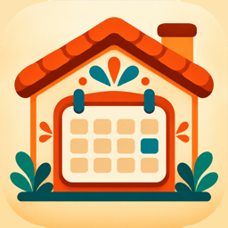

# CasitaCal

A personal, Skylight-style family calendar for a kitchen iPad.

CasitaCal turns an iPad into a wall/counter display that shows what the family is doing today and this week, color-coded by person. It reads from and writes to a **shared Google Calendar**, so everyone keeps using the normal Google Calendar app on their phones — add something on the iPad and it's on your phone; add something on your phone and it's on the iPad.

> Inspired by [Skylight Calendar](https://www.skylightframe.com/) and [Kinboard](https://github.com/svenger87/kinboard). This is a personal project, not a product.

---

## Contents

- [Features](#features)
- [How it works](#how-it-works)
- [Using CasitaCal](#using-casitacal)
- [Setup from scratch](#setup-from-scratch)
- [Development](#development)
- [Troubleshooting](#troubleshooting)
- [Roadmap](#roadmap)

---

## Features

### Calendar
- **Three views:**
  - **Week:** today on the left and the next days beside it (5 or 7), readable across the room. Today starts out wider; tap anywhere in a day to widen it instead, and double-tap a day to add an event on it. Each day shows its feast days and planned dinner at the bottom.
  - **Month:** a grid with event chips.
  - **Schedule:** a 30-day agenda.
- **Two-way Google Calendar sync:**
  - Changes on a phone appear on the iPad within about 60 seconds.
  - Changes on the iPad reach Google instantly.
- **Quick add:** type *"Soccer practice Tue 4pm"* and Google works out the date and time.
- **Full event editor** with:
  - all-day or timed events
  - start and end
  - repeat: daily, weekdays, weekly, every 2 weeks, monthly, yearly
  - people, location, notes
- **Edit and delete,** with *only this event* / *all repeats* for repeating events.
- **Offline cache:** the calendar shows instantly on launch and stays visible if Wi-Fi drops.

### Chores
- **A chore chart with a column per person.** Each chore is a big card: tap it to check it off, and a ring shows progress for the day.
- Chores can repeat:
  - once (missed one-off chores carry over to today until done)
  - every day, weekdays or weekends
  - weekly
  - on days you pick
- Set a **time of day** (morning, afternoon or evening) and **stars**. Kids earn ⭐️ per chore, with weekly totals under each name.
- **"Anyone" chores** get their own column, so whoever does it checks it off.

### Lists (Apple Reminders)
- **Your real Reminders lists.** CasitaCal shows and edits them, including lists shared with other Apple IDs, like a family Shopping List.
- They stay in sync with the Reminders app, Siri ("add milk to my Shopping List"), Apple Watch and everyone's phones.
- **Choose lists** decides which lists appear on each device. On first run it shows lists with "shopping" or "grocery" in the name.
- Quick add keeps the keyboard up so you can rattle off a whole grocery run.
- Tap to check off. Completed items drop to the bottom, and **Clear** removes them for everyone sharing the list.

### Meals and recipes
- **A rolling seven-day meal plan** with today on the left and breakfast, lunch, dinner and snacks down. Dinner gets big photo tiles. Saved recipes are mains or sides: plan a main with any number of sides (each with its own recipe), or start from a side and add the main later. Each side is listed under the main dish on the Meals grid; until there's a main, it says "No main yet". Show only the meals you plan.
- **Press and hold a meal to move it** to another day or slot. Drop it on a taken spot and the two swap. Hold it over a week arrow to reach another week.
- **Paste a recipe link** and CasitaCal pulls out the photo, ingredients, steps, times and servings. It reads the schema.org recipe data most recipe sites publish, so you skip the life story and ads. Pages without recipe data still give a title and photo.
- **Share from Safari:** on iPhone or iPad, tap Share → **CasitaCal**, pick a day and meal, and it lands on the kitchen iPad.
- **Recipe box:** every recipe you add is saved, searchable by name or ingredient, and one tap to plan again.
- **Cooking view:** big text, ingredients you can tick off, numbered steps you tap to keep your place, and your own notes ("double the garlic").
- **Add to list…** (in a recipe's Ingredients) opens a checklist of tidied-up ingredients ("Ground beef (1 ½ pounds)") to send to a Reminders list. Nothing starts ticked, so you pick exactly what you need, and things that already look like they're on the list are flagged. Nothing is ever added automatically.
- **Tonight's dinner** shows at the bottom of today on the Week view and on the slideshow, with its photo (after 8 PM the slideshow shows tomorrow's). Tap it on Week to open the recipe.
- Meals without a link can have a photo from your library, or just a name. **Recent** suggestions make repeat meals one tap, and typing a name offers matching saved recipes.

### Daily info
- **Optional topics next to the weather,** all off until chosen in Settings: Catholic feast days, coming-up events, national days, today in history, and a thought for the day. Tap for details.
- **Catholic days** follow the U.S. calendar, worked out on the device: holy days, days of obligation, and feast days, with a story and ideas for food and things to do. Find a recipe for a feast-day dish without leaving the app and save it, plan it for dinner or add it as a side. Add a feast to the calendar and it shows at the bottom of that day on every household device. Moved feasts and lifted obligations are handled for each year.
- **Show them on the calendar** with a setting, or use **Add to family calendar** on a single day. Nothing is added to Google by itself.
- Events can be added without an app update by editing `docs/daily/events.json`.

### Family
- **Profiles:** each person gets a name, an emoji avatar and a color. Colors match Google Calendar's 11 event colors.
- **Automatic "who's it for":** CasitaCal works out each event's people from its color or the names in its title. Details are under [Who's it for?](#whos-it-for).
- **Avatar filter:** tap a person in the header to hide or show their events.

### Kitchen display
- **Header:** big clock and date, plus current weather and today's high and low. Tap the weather for a 5-day forecast.
- **Photo slideshow when idle:** after a few minutes untouched, the iPad becomes a photo frame. It shows an album you choose (ideally an iCloud Shared Album the whole family adds to), with the time, weather and next event on top.
- **Night clock:** turns on about 30 seconds after the kitchen lights go off, using the screen brightness that Auto-Brightness picks (no setup; keep Auto-Brightness on). It can also come on at set night hours, when the screen dims to a soft clock. A touch brings the calendar back.
- **Walk-up wake (optional):** during the slideshow, the front camera looks for a face and wakes the display when someone walks up. Frames are checked on the iPad and never recorded or saved.
- Waking always returns to the **calendar, showing today**.
- **Weather** shows the town it's for (e.g. "Oak Creek, WI").
- The screen never auto-locks while the app is open.
- Works in landscape and portrait.
- A warm, soft palette with large touch targets.

### iPhone
- The same app runs on iPhone with a tab layout for calendar, chores, lists and meals, and sees the same household as the iPad.

---

## How it works

```
 Phones (Google Calendar app) ──┐
                                ├──►  Shared Google Calendar  ◄──►  CasitaCal on the kitchen iPad
 Google Calendar on the web  ───┘         (source of truth)
```

- **Google Calendar holds the data for events.** There's no CasitaCal server. The iPad talks directly to Google's Calendar API.
- **Sync:**
  - The visible dates refresh when the app opens, when it returns to the foreground, after every change you make, and every 60 seconds while it's on screen.
  - Results are cached on the iPad.

### Who's it for?

Every event is assigned to zero or more family members. Events with nobody assigned show for **Everyone** in a neutral warm gray. CasitaCal checks these in order and the first match wins:

| # | Signal | Example | Set from |
|---|--------|---------|----------|
| 1 | **CasitaCal multi-person tag** | Soccer → Emma *and* Joe | iPad only. It's stored in the event's hidden `extendedProperties`. |
| 2 | **Google event color** | Event colored *Peacock* → Joe | Any phone, the web, or the iPad |
| 3 | **Name or nickname in the title** | "Emma soccer", "Dad's dentist" | Just write the title naturally |

- Title matching is whole-word and ignores capitals and accents. "Joe" matches *"JOE's checkup"* but not *"Joey's party"*.
- When you pick people on the iPad:
  - **One person:** CasitaCal sets the event's Google color to that person's color, so phones show it the same way.
  - **Several people:** it uses the first person's color and adds the hidden multi-person tag.

### Privacy
- Google sign-in tokens live in the iPad's **Keychain**.
- Events are cached in the app's private storage and deleted when you sign out.
- Your calendar is sent nowhere except Google. Optional **Daily info** topics fetch dates from Wikipedia and a small events file from this project's site, with no personal details.
- See the [privacy policy](https://joeguardiola.github.io/casitacal/privacy.html).

---

## Using CasitaCal

### Getting around
| Want to… | Do this |
|---|---|
| Switch view | **Week / Month / Schedule** at the top right |
| Move through time | Swipe left or right, or use the **‹ ›** arrows. **Today** jumps back. |
| Read a busy day | Tap anywhere in the day in Week to widen the column |
| Add an event on a certain day | Double-tap that day in Week |
| Jump to a specific day | Tap any cell in Month |
| Hide someone's events | Tap their avatar in the header. Tap again to show them. |
| See an event's details | Tap the event |

### Adding an event
1. Tap the orange **+** button at the bottom right.
2. Type it like you'd say it:
   - `Dentist Fri 3:30pm`
   - `Soccer practice every Tuesday 4pm`
   - `Grandma visiting Dec 20-23`
3. Tap the avatars of the people it's for. Leave them all off for *Everyone*.
4. Tap **Add**.

For times, repeats, a location or notes, tap **More options** to open the full form. New events default to the day you're looking at.

### Editing, reassigning, deleting
Tap an event to open its details, then:
- **Who's this for?** Tap avatars, then **Save**. The footer explains why an event is currently assigned the way it is.
- **Edit event** changes the title, time, all-day, people, location or notes.
- **Delete event** removes it from everyone's Google Calendar.

For **repeating events**, CasitaCal asks whether you mean **Only this event** or **All repeats**.
- Editing *all repeats* keeps the series' original start date and applies your new time-of-day and length.
- To change the repeat *pattern* of an existing series, use Google Calendar.

### Tagging from your phone
In the Google Calendar app, open an event, tap **Edit**, choose a **color**, and pick that person's color:

| Google color | Default person* |
|---|---|
| Peacock (blue) | Joe |
| Grape (purple) | Mom |
| Sage (green) | Kid 1 |
| Tangerine (orange) | Kid 2 |

\*Change names and colors in **Settings → Family**. Each color belongs to one person.

Or just put their name in the title: *"Emma piano"*.

### Photo slideshow
1. On any family iPhone, open the **Photos** app and tap **+ → New Shared Album** (e.g. "Kitchen Frame"). Invite everyone, **including the Apple ID the iPad uses**.
2. On the iPad, accept the invite in the Photos app.
3. In CasitaCal, go to **Settings → Kitchen Display → Photos → Allow photo access → Full Access**, then **Choose album**.
4. Tap **Start slideshow** to preview it. It also starts by itself when the iPad sits idle (set the delay in **Settings → Kitchen Display**). Tap anywhere to return to the calendar.

### Chores, lists and meals how-to
- **Add a chore:**
  1. Go to **Chores → +**.
  2. Pick an emoji, type a name ("Make bed"), and pick who does it. "Anyone" is for shared jobs.
  3. Choose how often, the time of day and the stars.
- **Edit or delete a chore:** long-press its card.
- **Look at other days:** use **‹ ›** at the top of Chores.
- **Lists:**
  - Pick a list on the left and type in **Add an item**, pressing return after each one.
  - Swipe an item left to delete it.
  - Tap **⋯** to rename or delete the list.
  - Tap **New list** for more lists.
- **Meals:**
  - Tap any square to plan that meal. Pick from **Recent** to reuse one.
  - Use **Meals shown** to hide breakfast or lunch, or show snacks.

> Chores, lists and meals are stored on the iPad for now. Once the paid Apple team is set up, they sync through iCloud, and a later milestone shares them with a second Apple ID.

### Settings
- **Family:**
  - Add, edit or remove people.
  - Set each person's name, avatar, color, adult or kid, and **Also called** nicknames (e.g. `Dad, Papa`), separated by commas.
  - Swipe a row to delete it. Tap **Edit** to reorder.
- **Calendar:** the Google account, the **family calendar** (only calendars you can edit are listed), whether the week starts on **Monday** (the default) or Sunday, and sign out.
- **Daily Info ›:** which topics rotate next to the weather, and the Catholic feast-day options.
- **Kitchen Display ›** (iPad):
  - Slideshow: the idle delay (off, or 2, 5, 10, 15 or 30 minutes), the album, and walk-up wake.
  - Night clock: when the lights go off, and at set hours (10:00 PM to 6:30 AM by default) with its brightness.
  - Weather appears here only when something's wrong with it.
- Sync and weather status lines show only when there's a problem.

### Locking the iPad to CasitaCal (Guided Access)
iPadOS's Guided Access keeps the kitchen iPad inside the app:
1. On the iPad, go to **Settings → Accessibility → Guided Access**, turn it on, and set a passcode.
2. Open CasitaCal and **triple-click** the top (or Home) button, then tap **Start**.
3. To exit, triple-click and enter the passcode.

Also go to **Settings → Display & Brightness → Auto-Lock → Never** while the iPad is plugged in. CasitaCal also keeps the screen awake on its own.

---

## Setup from scratch

### What you need
- A Mac with **Xcode 26+**.
- **[XcodeGen](https://github.com/yonaskolb/XcodeGen):** `brew install xcodegen`
- An **Apple Developer account**:
  - A free account works for testing, but those installs expire after 7 days.
  - A paid account ($99/yr) lasts a year and is needed later for iCloud and weather.
- A **Google account** with the shared family calendar.
- An iPad on **iPadOS 18+**.

### 1. Clone and configure
```sh
git clone git@github.com:joeguardiola/casitacal.git
cd casitacal
git config core.hooksPath .githooks              # turn on the secret-blocking pre-commit hook
cp Config/Local.xcconfig.example Config/Local.xcconfig
```

`Config/Local.xcconfig` is **gitignored**. It holds your personal values:
```
DEVELOPMENT_TEAM = <your Apple team ID>
GOOGLE_CLIENT_ID = <id>.apps.googleusercontent.com
GOOGLE_REVERSED_CLIENT_ID = com.googleusercontent.apps.<id>
```

Find your team ID in Xcode → Settings → Accounts, or at developer.apple.com → Membership. The reversed client ID is the client ID with its parts reversed, as shown.

### 2. Create the Google OAuth client
In the [Google Cloud Console](https://console.cloud.google.com), signed in with the account that owns or can edit the family calendar:

1. **Create a project**, e.g. `CasitaCal`.
2. **APIs & Services → Library →** enable **Google Calendar API**.
3. **Google Auth Platform → Get started.** Enter an app name and support email, set the audience to **External**, and enter a contact email.
4. **Branding.** Google requires these before you can publish:
   - **Application home page:** `https://joeguardiola.github.io/casitacal/`
   - **Privacy policy:** `https://joeguardiola.github.io/casitacal/privacy.html`
   - **Authorized domains:** `joeguardiola.github.io`
   - **App logo:** leave empty. A logo triggers a slow brand review.
5. **Data Access → Add or remove scopes.** Add `.../auth/calendar.events` and `.../auth/calendar.readonly`.
6. **Audience → Publish app.** ⚠️ Don't skip this. In *Testing* mode, Google signs you out every 7 days. Published-but-unverified is fine for a family (fewer than 100 users).
7. **Clients → Create client.** Type **iOS**, bundle ID `com.guardiola.casitacal`. Copy the client ID into `Config/Local.xcconfig`.

The home page and privacy policy are served by GitHub Pages from [`docs/`](docs/), at Settings → Pages → `main` branch, `/docs` folder. If you fork the project, point these at your own Pages URL.

### 3. Build and run in the simulator
```sh
xcodegen generate
open CasitaCal.xcodeproj        # pick an iPad simulator and press ⌘R
```

### 4. Install on a real iPad
1. Connect the iPad by cable, unlock it, and tap **Trust This Computer**.
2. On the iPad, turn on **Settings → Privacy & Security → Developer Mode**. It restarts; confirm **Turn On**.
3. Build and install:
   ```sh
   xcrun devicectl list devices      # find the iPad's identifier
   xcodebuild -scheme CasitaCal -destination 'platform=iOS,name=<iPad name>' \
     -derivedDataPath build -allowProvisioningUpdates build
   xcrun devicectl device install app --device <iPad id> build/Build/Products/Debug-iphoneos/CasitaCal.app
   xcrun devicectl device process launch --device <iPad id> com.guardiola.casitacal
   ```
   Or select the iPad in Xcode and press ⌘R.
4. **Free Apple account only:** on the iPad, go to **Settings → General → VPN & Device Management → Developer App** and tap **Trust**.

### 5. Turn on weather (paid Apple Developer account)
WeatherKit only works for apps signed by a paid team. Free-team builds show `--°`.
1. Go to [developer.apple.com](https://developer.apple.com/account) → **Certificates, IDs & Profiles → Identifiers** → `com.guardiola.casitacal`.
   - Under **Capabilities**, tick **WeatherKit**.
   - Under **App Services**, tick **WeatherKit**.
   - Click **Save**. It can take about 30 minutes to start working.
2. In `Config/Local.xcconfig`, add:
   ```
   DEVELOPMENT_TEAM = <paid team ID>
   CASITACAL_ENTITLEMENTS = CasitaCal/CasitaCal.entitlements
   CASITACAL_HAS_WEATHERKIT = YES
   CASITACAL_HAS_ICLOUD = YES      # turns on iCloud sync for chores, lists, meals and family
   ```
3. Rebuild and install. Tap the weather in the header, then **Allow location**.

### 6. Family on TestFlight (install once, updates arrive by themselves)
1. **App Store Connect → Users and Access**: add each family member, then **TestFlight → Internal Testing**: add them to a group (ours is "Family"). They accept the email invite **on the device signed in to their Apple ID**.
2. **CloudKit schema → production** (only when the data model changes, and before the first upload):
   1. Run a debug build on a device with `-cloudKitSchemaSetup YES` (`xcrun devicectl device process launch … com.guardiola.casitacal -- -cloudKitSchemaSetup YES`). It registers every record type **and the `cloudkit.share` type that family invites need**, using throwaway data.
   2. [CloudKit Console](https://icloud.developer.apple.com) → Development → **Deploy Schema Changes**.
   3. That debug install replaces TestFlight on the device: reinstall from TestFlight afterwards (data is kept).
3. **Upload:** `scripts/testflight.sh` (patch bump), `minor` or `major`. It needs a clean git tree, bumps the version, uploads, commits, tags `vX.Y.Z` and pushes. Add a `## X.Y.Z` section to `CHANGELOG.md` first.
4. **Invite family to the household:** on the iPad, Settings → Family sharing → **Invite family…** → Messages.
5. **Never expire:** TestFlight builds stop opening after 90 days.
   - `scripts/install-keepalive.sh` installs a weekly Mac job that uploads a maintenance build once the newest one is 60 days old.
   - On each device, TestFlight → CasitaCal → **Automatic Updates: On**, so new builds install themselves. No reinstalling.
   - Safety net: Settings → About shows "TestFlight build good until …", and the header shows an orange reminder in the last 14 days.

### 7. First launch
1. Tap **Sign in with Google**.
2. On **"Google hasn't verified this app"**, tap **Advanced → Go to CasitaCal (unsafe)**. That's expected for a personal app.
3. Google shows name and email first. Tap **Continue**, then **tick both calendar permissions**.
4. Pick your **family calendar**.
5. In **Settings → Family**, set up names, colors and nicknames.

---

## Development

### Project layout
```
project.yml                  XcodeGen spec (the .xcodeproj is generated and gitignored)
Config/
  Base.xcconfig              committed settings with empty placeholders
  Local.xcconfig             your team ID and Google client ID (gitignored)
CasitaCal/
  App/                       app entry, root layout (iPad rail / iPhone tabs)
  DesignSystem/              palette, avatars, cards
  Models/                    Member and MemberStore, CalendarEvent, EventDraft, AppCalendar (week start)
  Services/Persistence/      Core Data household store (schema in code, CloudKit-ready)
  Features/Chores|Lists|Meals/  chore chart and editor, shared lists, weekly meal plan
  Services/Google/           sign-in, Calendar REST client, DTOs, EventMapper (who's it for)
  Features/Calendar/         EventStore (sync and cache), layout math, Week/Month/Schedule, sheets
  Features/Header/           clock, weather badge and forecast, avatar filter bar
  Features/Kiosk/            slideshow and night-clock overlays
  Features/Photos/           album picker and preview
  Services/Weather/          WeatherKit and one-shot location
  Services/Photos/           PhotoKit album access
  Services/Kiosk/            idle and night logic, touch watcher, screen dimming
  Features/Settings/         family, Google and calendar settings
CasitaCalTests/              Swift Testing unit tests
docs/                        GitHub Pages: home page and privacy policy
.githooks/pre-commit         blocks commits containing credentials
```

### Tests
```sh
xcodebuild test -scheme CasitaCal -destination 'platform=iOS Simulator,name=iPad Pro 13-inch (M5)'
```

The tests cover:
- event layout: overlaps, overnight events, all-day ranges, DST, month grid, Monday weeks
- Google parsing and request bodies
- "who's it for" mapping
- series retiming
- cache merging
- member storage

### Secrets policy
This repo is **public**. Never commit credentials or personal IDs.
- Personal values go only in `Config/Local.xcconfig`. `Info.plist` references them as build variables (`$(GOOGLE_CLIENT_ID)`), so the committed plist contains only variable names.
- `.gitignore` covers `.env`, `GoogleService-Info.plist`, `client_secret*.json`, token files, `.p8`/`.p12`/`.pem` keys and provisioning profiles.
- `.githooks/pre-commit` refuses commits that contain Google client IDs or tokens, API keys, private keys, GitHub tokens, Apple team IDs, or any of the files above. Turn it on once per clone with `git config core.hooksPath .githooks`. **Don't bypass it.**
- At runtime, OAuth tokens live in the Keychain, never in files.

---

## Troubleshooting

| Problem | Fix |
|---|---|
| **"Google hasn't verified this app"** | Expected. Tap **Advanced → Go to CasitaCal (unsafe)**. |
| **"Access blocked"** with no *Advanced* link | The OAuth app is still in *Testing*. Go to Google Auth Platform → Audience → **Publish app**, or add yourself as a test user. |
| **Consent screen only lists name, email and profile picture** | That's step one. Tap **Continue**, and the calendar permissions come next. Tick both. |
| **"Calendar access wasn't granted"** | Sign out in Settings, sign in again, and tick both calendar checkboxes. |
| **Signed out after a week** | The OAuth app is in Testing mode. Publish it (see setup step 2.6). |
| **App won't open after a week** | Free Apple account installs expire after 7 days. Reinstall, or use a paid account. |
| **App won't open: "untrusted developer"** | Settings → General → VPN & Device Management → **Trust**. |
| **"Developer Mode disabled"** when installing | iPad Settings → Privacy & Security → **Developer Mode**. |
| **Everything is gray (Everyone)** | Give people real names or nicknames in Settings, or tap events to assign them. See [Who's it for?](#whos-it-for). |
| **Orange "Sync problem"** in the toolbar | Usually Wi-Fi. Cached events stay visible. Tap the badge to retry. |
| **Weather shows `--°`** | Needs the paid Apple team with WeatherKit on (see setup step 5). Then tap the weather and choose **Allow location**. |
| **Slideshow album isn't listed** | The iPad's Apple ID must have accepted the shared album invite, and Shared Albums must be on: iPad Settings → Apps → Photos. |
| **A phone change hasn't appeared** | Wait up to 60 seconds, or switch views to force a refresh. |
| **"iCloud upload failed"** or **invite button spins** | Usually the production CloudKit schema is behind. Do setup step 6.2, then reopen CasitaCal. "Cannot create new type cloudkit.share" means exactly this. |
| **Can't install from TestFlight on a phone** | The invite was accepted with a different Apple ID. Each person accepts on their own device. |
| **App won't open after ~90 days** | The TestFlight build expired. Install the latest in TestFlight, and check the keep-alive job (step 6.5). Log: `~/Library/Logs/CasitaCal-keepalive.log`. |

---

## Roadmap

| Milestone | Status |
|---|---|
| 1. App shell, design system, family profiles | ✅ Done |
| 2. Google sign-in, Day/Week/Month/Schedule views, "who's it for" | ✅ Done |
| 3. Add, edit and delete events, quick add, repeats, offline cache | ✅ Done |
| 4. Kiosk: weather (WeatherKit), night mode, idle photo slideshow (iCloud Shared Album) | ✅ Done (weather needs the paid team) |
| 5. Chores, lists and meals | ✅ Done |
| 6. iCloud sync, sharing across Apple IDs, iPhone companion layout | ✅ Done (sync verified iPad ↔ iPhone) |
| 7. Reminders-backed lists, recipe import + Share from Safari, dark-room night clock, walk-up wake | ✅ Done |
| 8. Distribution to family (TestFlight), family invites, auto-renewing builds | ✅ Done |
| 9. Ingredients → shopping list, tonight's dinner on the dashboard | ✅ Done |

---

Made for our casita. 🏡
